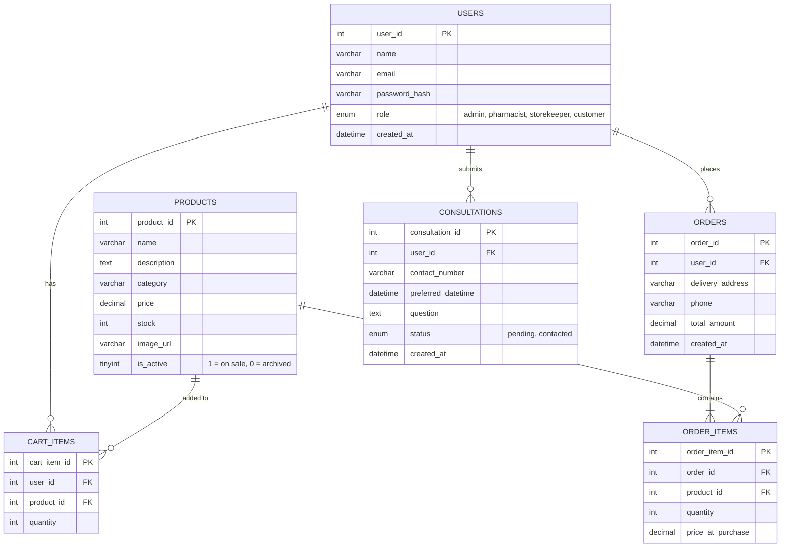
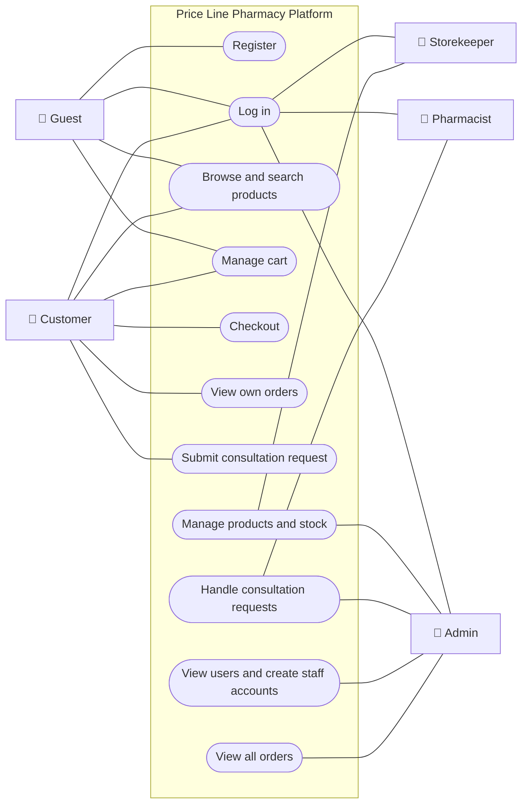
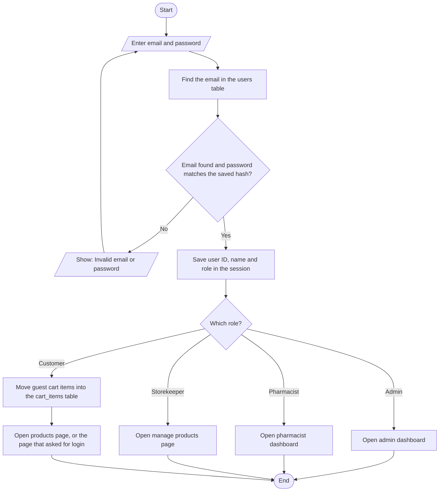
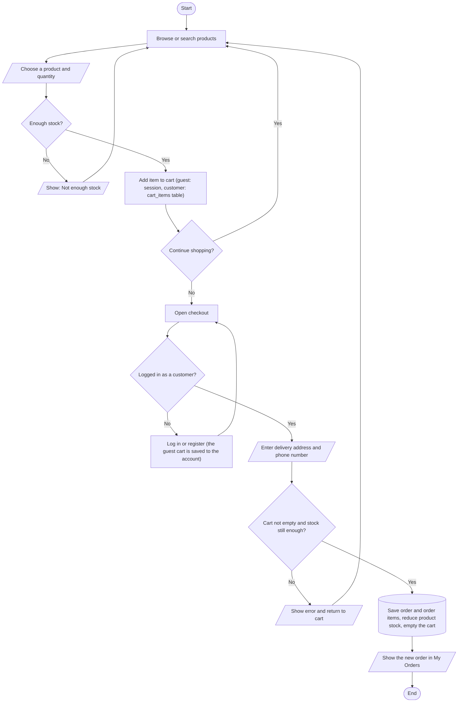

## 1. Student Details

| Field | Your Answer |
|---|---|
| Candidate Name | Chuah Jo Yee |
| NRIC Number | ... |
| Date Submitted | DD/MM/YYYY |

---

## 2. Project Title

**Price Line Pharmacy Platform**

### One-line summary

A web application where customers browse, search and order pharmacy products online, with a cart, checkout and pharmacist consultation requests.

---

## 3. Problem Statement & Purpose

> What problem does your application solve? Who is it for? Why is it useful?

Customers often need to visit a pharmacy in person to buy everyday medicines and health products, check whether an item is in stock, or ask a pharmacist a question. This platform is for pharmacy customers who want to shop from home, and for pharmacy staff who need one place to manage products, stock and customer enquiries. Customers can search products by category, order online and request a call from a pharmacist. Staff get separate, role-limited tools, so each person only handles the work they are responsible for.

---

## 4. Tech Stack

> Required: HTML, CSS, PHP, MySQL.

| Layer | Technology |
|---|---|
| Markup | HTML |
| Styling | CSS, Bootstrap 5 (homepage banner carousel only) |
| Client-side | JavaScript |
| Server-side | PHP |
| Database | MySQL |

---

## 5. Types of Users (Roles)

> Minimum **3 roles**. Each role must have different levels of access.

| Role | Description |
|---|---|
| Admin | Full access to the staff panel. Views user accounts, creates staff accounts, manages products, views all orders and handles consultation requests. |
| Pharmacist | Views customer consultation requests and marks them as contacted after calling the customer. Can view products but not change them. |
| Storekeeper | Adds, edits and removes products and keeps stock levels up to date. |
| Customer | Browses and searches products, adds them to the cart, checks out, views their own orders and submits consultation requests. |

### Role-Based Access Matrix

> Mark what each role can do. Add or remove rows to match your features.

| Feature / Page | Admin | Pharmacist | Storekeeper | Customer | Guest (not logged in) |
|---|:---:|:---:|:---:|:---:|:---:|
| Register account | ❌ | ❌ | ❌ | ❌ | ✅ |
| Login | ✅ | ✅ | ✅ | ✅ | ✅ |
| Browse and search products | ✅ | ✅ | ✅ | ✅ | ✅ |
| Add to cart and manage cart | ❌ | ❌ | ❌ | ✅ | ✅ |
| Checkout (place an order) | ❌ | ❌ | ❌ | ✅ | ❌ |
| View own orders | ❌ | ❌ | ❌ | ✅ | ❌ |
| View all orders | ✅ | ❌ | ❌ | ❌ | ❌ |
| Manage products and stock | ✅ | ❌ | ✅ | ❌ | ❌ |
| Submit consultation request | ❌ | ❌ | ❌ | ✅ | ❌ |
| Handle consultation requests | ✅ | ✅ | ❌ | ❌ | ❌ |
| View users and create staff accounts | ✅ | ❌ | ❌ | ❌ | ❌ |

A guest can fill a cart before logging in. The cart is saved to their account when they log in or register, and they must be logged in as a customer to check out.

---

## 6. Features

### 6.1 Core Features (must have)

- [ ] User registration and login
- [ ] Role-based access control (each role sees/does different things)
- [ ] Data management (Create, Read, Update, Delete)
- [ ] Add to Cart product(s)
- [ ] Checkout Page

### 6.2 Extra Features (nice to have)

- [ ] Product search and category filter
- [ ] Consultation request form

### 6.3 Feature Descriptions

> Briefly explain each core feature: what it does and which role uses it.

| Feature | Description | Role(s) |
|---|---|---|
| User registration and login | Customers register themselves. Admins create staff accounts. All users log in with email and password, and are sent to the correct area for their role. | Admin, Pharmacist, Storekeeper, Customer |
| Role-based access control | Each role only sees its own pages: customers shop, storekeepers manage products and stock, pharmacists handle consultations, and admins manage everything. | Admin, Pharmacist, Storekeeper, Customer |
| Data management (CRUD) | Admins and storekeepers add, view, edit and delete products, including name, price, stock, category and image. A product that has already been ordered is archived (hidden from the shop) instead of deleted, so the order history is kept. | Admin, Storekeeper |
| Add to Cart | Guests and customers add products to their cart, change quantities or remove items, and see the running total. | Guest, Customer |
| Checkout Page | Customers review their cart, enter delivery details and place the order. Stock goes down automatically once the order is placed. | Customer |

---

## 7. Data Management System

> Which data can users create, view, edit and delete? Who is allowed to do what?

| Data / Entity | Create | Read | Update | Delete |
|---|---|---|---|---|
| Users | Guest (registers as Customer), Admin (creates staff accounts) | Admin (all users) | None | None |
| Products | Admin, Storekeeper | Everyone, including Guest (active products only) | Admin, Storekeeper | Admin, Storekeeper (archived instead if already ordered) |
| Cart items | Guest, Customer | Guest, Customer (own cart) | Guest, Customer (change quantity) | Guest, Customer (remove item) |
| Orders | Customer (at checkout) | Customer (own orders), Admin (all orders) | None | None |
| Consultation requests | Customer | Customer (own requests), Pharmacist, Admin | Pharmacist, Admin (mark as contacted) | Admin |

A guest's cart is kept in the session. A customer's cart is kept in the `cart_items` table.

---

## 8. Database Design

> Minimum **4 tables** with at least **3 linkages** (foreign keys) between them.

### Entity Relationship Diagram (ERD)

---

## 9. Use Case Diagram

> Show the actors (roles) and what each can do in the system.

Staff can also browse and search products, but they cannot use the cart.

### Flowchart 1: Login and role-based routing

### Flowchart 2: Shopping and checkout

---

## 10. Presentation Checklist

- [ ] Can explain the purpose of the application
- [ ] Can justify design choices (why this database structure, why these roles)
- [ ] Can demo every role
- [ ] Can answer questions about my own code
- [ ] Submitted on time
